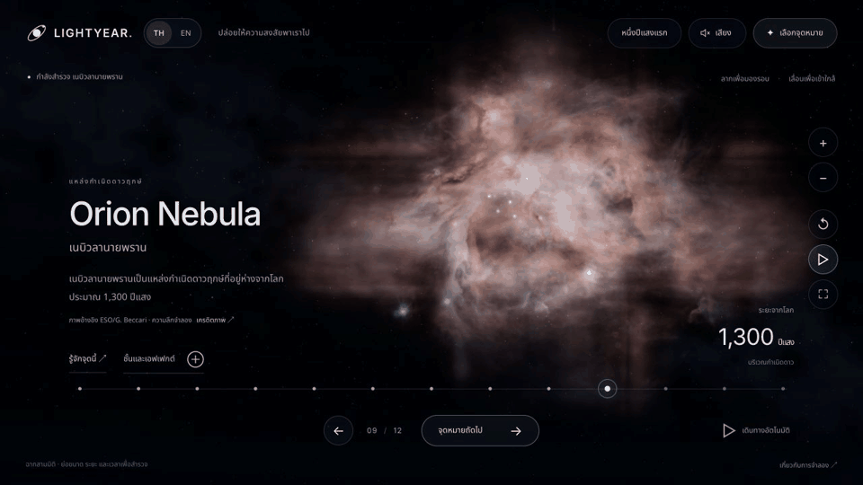

# LIGHTYEAR 🌌

เว็บสำรวจอวกาศสามมิติ ภาษาไทยและอังกฤษ ตั้งแต่โลกไปจนถึงกาแล็กซีแอนโดรเมดา

An immersive Thai/English space atlas with 13 explorable scenes, spatial gas and dust volumes, and environmental sound.

[Open the hosted atlas](https://lightyear-space-atlas.aek.chatgpt.site/?scene=orion&lang=th) · [English](https://lightyear-space-atlas.aek.chatgpt.site/?scene=orion&lang=en)



## Explore

- Drag to orbit objects through 360°, including views from above and below.
- Scroll or use + / − to approach; reset restores the starting view.
- Explore Earth, the Oort Cloud, interstellar space, Proxima Centauri, Barnard’s Star, Luhman 16, Sirius, Vega, Pleiades, Orion, Sagittarius A*, the Large Magellanic Cloud and Andromeda.
- Open 39 feature descriptions and primary astronomical sources.
- Switch TH / EN while retaining the selected feature and effect speed.
- Enable sound explicitly: Earth uses nature recordings; other scenes use designed environmental ambience.
- Smaller screens use fewer volume samples and spatial stars.

## Run locally

The application is a static site with locally bundled Three.js, fonts and media. It has no build or package-install step.

```sh
git clone https://github.com/aelde/lightyear-space-atlas.git
cd lightyear-space-atlas
python3 -m http.server 8765 --bind 127.0.0.1 --directory dist
```

Open <http://127.0.0.1:8765/> in a browser that supports WebGL 2. Serve over HTTP; JavaScript modules do not work by opening `index.html` directly as a local file.

Direct scene links are supported, for example:

```text
http://127.0.0.1:8765/?scene=orion&lang=th
http://127.0.0.1:8765/?scene=andromeda&lang=en
```

## Project files

| Path | Purpose |
| --- | --- |
| `dist/` | Complete runnable static site |
| `dist/flight.js` | Camera, navigation, controls, inspectors and audio integration |
| `dist/flight-worlds.js` | Scene assembly and lifecycle |
| `dist/volume-field.js` | Integration of light through XYZ density fields |
| `dist/nebula-renderer.js` | Nebular gas, dust and spatial stars |
| `dist/galaxy-renderer.js` | Stellar disks, bulges, asymmetric bars and dust |
| `dist/stellar-surfaces.js` | Stellar surface details |
| `dist/deep-details*.js` | Bilingual feature content and astronomical sources |
| `dist/assets/` | Local images, fonts, recordings and credits |
| `source-assets/` | Original generated illustrations used in the atlas |
| `review/` | Screenshots and verification notes |
| `wave11-language-verification.txt` | Language verification |
| `wave13-volume-verification.txt` | Spatial-volume verification and wave14 refinement |
| `.openai/hosting.json` | Existing Sites deployment configuration |

## Scientific interpretation

ฉากใช้แบบจำลองเพื่อให้สำรวจได้ ความลึกและด้านหลังที่ไม่มีข้อมูลสังเกตไม่ได้อ้างว่าเป็นการวัดจริงทั้งหมด

Destinations are ordered by distance from Earth, not by a single flight path. Scale, brightness, color and time are adjusted for exploration. Unobserved depths and back sides are modeled; illustrative cluster-star positions are not a precise catalogue. Galaxies retain their naturally flattened structure. Black-hole light effects are artistic rather than full general-relativistic ray tracing. The distant interstellar sky uses a spherical photographic panorama alongside spatial nearby stars.

The orbit GIF is a sequence of actual website screenshots, not a real-time performance benchmark. Mobile viewport behavior was checked on a computer; physical phone hardware and every GPU were not tested.

## Credits

Credit and license details are retained with the assets:

- [Astronomical observation references and adaptations](dist/assets/observations/CREDITS.txt)
- [Earth imagery](dist/assets/earth/CREDITS.txt)
- [Audio recordings](dist/assets/audio/CREDITS.txt)
- [Three.js](dist/vendor/CREDITS.txt) and [license](dist/vendor/LICENSE.txt)
- [Inter](dist/assets/fonts/Inter-OFL.txt) and [Noto Sans Thai](dist/assets/fonts/Noto-Sans-Thai-OFL.txt)

Generated illustrations and the original development notes are documented in [README.txt](README.txt). Asset-specific licenses remain applicable.
